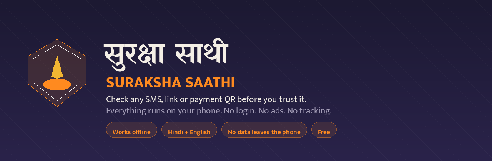

<div align="center">



# Suraksha Saathi · सुरक्षा साथी

**Check any SMS, WhatsApp message, link or payment QR before you trust it.**
Everything runs on your phone. No login. No ads. No tracking. Nothing is uploaded.

[](https://github.com/premiumroy/BharatSurakshaSaathi/actions/workflows/android.yml)
[](https://github.com/premiumroy/BharatSurakshaSaathi/actions/workflows/release.yml)


**[हिन्दी में पढ़ें](#हिन्दी)** &nbsp;·&nbsp; [Privacy policy](PRIVACY_POLICY.md) &nbsp;·&nbsp; [Install guide](INSTALL_HINDI.md) &nbsp;·&nbsp; [Languages](LANGUAGES.md)

</div>

---

## Why this exists

Digital arrest calls, fake KYC messages, loan-app threats, UPI collect-request fraud and job-fee scams hurt people in India every day. Most of them arrive as a message that *looks* official, and the person has to decide in seconds whether to trust it.

Suraksha Saathi gives that decision a second opinion. Paste the message, and it tells you plainly what it looks like and what to do next. It does this **on the phone**, with no account, no server and no network.

> This is a helpful check, not a guarantee. No app can catch every scam. **यह गारंटी नहीं है।**

## What it does

<table>
<tr><td width="50%" valign="top">

**Check a message**
Paste an SMS, WhatsApp message or any text. You get a clear verdict (Safe, Be Careful, Dangerous) with the specific reasons it was reached, and a plain-language "what to do now".

**Check a screenshot or photo**
Pick an image or take a photo. The text is read on the device by ML Kit and checked by the same engine.

**Check a payment QR**
Scan a UPI QR before paying. It warns about collect requests, pre-filled amounts, look-alike payee names and unknown handles.

</td><td width="50%" valign="top">

**Check a number**
Type a number and see whether its format looks unusual, offline.

**Voice in and out**
Speak the message, and hear the answer read aloud.

**If you were scammed**
The golden hour, 1930, how to freeze your card and UPI, reporting on cybercrime.gov.in, and saving evidence as a PDF.

</td></tr>
<tr><td valign="top">

**Learn**
A daily "Spot the Scam" game, this week's scams, a five-question call triage wizard, a family code word, and a helper wizard for setting up an elder's phone.

**Safety tools**
A dashboard of your checks, a shareable warning card, a Chakshu report helper for the Sanchar Saathi portal, a step-by-step guide to seeing how many SIMs are in your name, and a place to save the helplines from your own card.

</td><td valign="top">

**Saathi Agent** *(optional, off by default)*
Quiet background message watch, call screening with an offline number check, a daily phone-health check, and a warning if a screen-sharing tool and a money app were used together.

**Call Guard** *(started only by you)*
Live help during a call, with a visible ongoing notice while it listens. It never records audio and keeps no transcript.

</td></tr>
</table>

## How a check works


Rules live in versioned JSON (`app/src/main/assets/scam_rules.json`) with an id, a family, a weight, a language, examples and a changelog, so detection can improve without touching Kotlin. The engine also understands evasion tricks: spaced-out letters, look-alike characters, and mixed Hindi and English in the same message.

## Architecture


The domain layer is pure Kotlin with no Android dependency, which is why the scam engine has **228 unit tests** that run in seconds on a laptop with no emulator.

```
app/src/main/java/com/bharatsuraksha/saathi/
├── domain/          pure Kotlin: engine, models, learn, safety, upi, agent
├── data/            Room, DataStore, on-device inspectors
├── service/         notification listener, call screening, Call Guard
├── work/            the daily phone-health job
└── ui/              Compose screens, theme, navigation, i18n
```

## Privacy

This is the part that matters most, so it is stated plainly.

**What stays on your phone, and is never uploaded**

- The messages you check and their verdicts
- Your history and saved evidence
- Your blocklist and family contacts
- Your trusted bank helplines
- The family code word (encrypted with AES-GCM, key held in the Android Keystore)
- All settings

**What can leave the phone, only when you act**

- **Auto-check:** notification text is read on the device. It is not sent anywhere.
- **Online mode:** off by default. If you switch it on, enter your own server address, and tap "Send it", only that single message text goes to the server you configured. The app ships no API key, and the optional `backend/` proxy in this repo is where a key would live if you run one.
- **Report a wrong result:** opens the share sheet with the text pre-filled. Nothing is sent until you press send.

**Permissions, each optional and each explained on screen first**

`POST_NOTIFICATIONS` · `RECORD_AUDIO` · `CAMERA` · notification access · `READ_CONTACTS` · usage access · call screening role · `FOREGROUND_SERVICE_MICROPHONE` · `RECEIVE_BOOT_COMPLETED` · `VIBRATE`

The app deliberately **does not** request `QUERY_ALL_PACKAGES`, `READ_SMS`, location or `MANAGE_EXTERNAL_STORAGE`. See [PERMISSIONS.md](PERMISSIONS.md) for what each one does and how to turn it off.

**Delete everything** in one tap: Settings → Privacy and data → Delete all my data.

There is no analytics SDK, no crash reporting SDK, no advertising ID and no account. Read the full [privacy policy](PRIVACY_POLICY.md) (Hindi and English) or the [Play data safety answers](DATA_SAFETY.md).

## Languages

The interface ships in **32 languages**. Hindi and English are complete and verified. The rest are marked **BETA**, carry a beta badge in the picker, and fall back to Hindi for anything not yet translated. Every beta row has a "report a translation issue" link.

Scam detection is strongest in Hindi and English. [LANGUAGES.md](LANGUAGES.md) lists every language with its status and detection level, and explains how to add one by editing a single `strings.xml`.

`TranslationCompletenessTest` fails the build if any language file is missing a key, changes a placeholder (`%1$s`, `%s`, `%d`), or alters `1930`, `cybercrime.gov.in` or `sancharsaathi.gov.in`. A language cannot ship unless it passes.

## Install

**From a release** (no Play Store needed)

1. Download the APK from [Releases](https://github.com/premiumroy/BharatSurakshaSaathi/releases).
2. Allow "install unknown apps" for your browser or file manager.
3. Open the file and install.

Step-by-step Hindi instructions, including how to check the file, are in [INSTALL_HINDI.md](INSTALL_HINDI.md).

**Build from source**

```bash
git clone https://github.com/premiumroy/BharatSurakshaSaathi.git
cd BharatSurakshaSaathi

# unit tests (no emulator needed)
./gradlew :app:testDebugUnitTest

# debug APK
./gradlew :app:assembleDebug

# signed release APK + AAB
bash scripts/generate_keystore.sh      # once; never commit the output
./gradlew :app:assembleRelease :app:bundleRelease
```

Requires JDK 17 and the Android SDK with platform 35. The release build uses R8 with resource shrinking and ships `arm64-v8a` and `armeabi-v7a` only.

## Contributing

Contributions are welcome, especially translations and new detection rules.

- **Add a scam rule:** edit `app/src/main/assets/scam_rules.json` and add a matching labelled message to `ScamCorpusV2.kt`. The corpus is checked for precision and recall, so a rule that fires on genuine messages will fail the build.
- **Translate a language:** copy `app/src/main/res/values/strings.xml` into `values-b+<tag>/strings.xml` and translate the values. Keep every placeholder. See [LANGUAGES.md](LANGUAGES.md).
- **Report a wrong result:** use the "यह नतीजा गलत लगा" button in the app, or open an issue with the message text.

Before opening a pull request, run `./gradlew :app:testDebugUnitTest`. All 228 tests must pass. [QA_CHECKLIST.md](QA_CHECKLIST.md) has the manual checklist used before a release.

## Not a government app

Suraksha Saathi is an independent app. It is **not** a government app, and it is not affiliated with, endorsed by or connected to Sanchar Saathi, I4C, the Cyber Crime Coordination Centre, any bank, or any authority. Helpline numbers and portal addresses are shown for your convenience only.

## Credits

Made by **Roy Limited** · Owner: **Prashant Dobriyal** · known online as **Premium Roy**

The credit line lives in one place, `ui/about/Credits.kt`.

## License

[MIT](LICENSE). Use it, fork it, ship it, and help someone avoid a scam.

---

<a id="हिन्दी"></a>
## हिन्दी

**सुरक्षा साथी** एक मुफ़्त, ऑफ़लाइन सुरक्षा ऐप है। कोई भी संदिग्ध SMS, WhatsApp मेसेज, लिंक या भुगतान QR इससे जाँचें और साफ़ जवाब पाएँ: सुरक्षित, सावधान, या ख़तरा, साथ में कारण और आगे क्या करना है।

सारी जाँच आपके फ़ोन में होती है। कोई लॉगिन नहीं, कोई विज्ञापन नहीं, कोई ट्रैकिंग नहीं, और कुछ भी अपलोड नहीं होता। हिंदी और अंग्रेज़ी के अलावा 30 भाषाएँ हैं, जो बीटा हैं और जिनमें जो छूट जाए वह हिंदी में दिख जाता है।

ठगी हो जाने पर ऐप सबसे ज़रूरी कदम बताता है: 1930, बैंक को सूचना, cybercrime.gov.in पर शिकायत, और सबूत सहेजना।

**यह मददगार जाँच है, गारंटी नहीं। यह गारंटी नहीं है।**

यह ऐप सरकारी नहीं है और Sanchar Saathi, I4C, किसी बैंक या किसी प्राधिकरण से जुड़ा नहीं है।

इंस्टॉल करने का तरीका [INSTALL_HINDI.md](INSTALL_HINDI.md) में है।

<div align="center">

**Made by Roy Limited**

</div>
