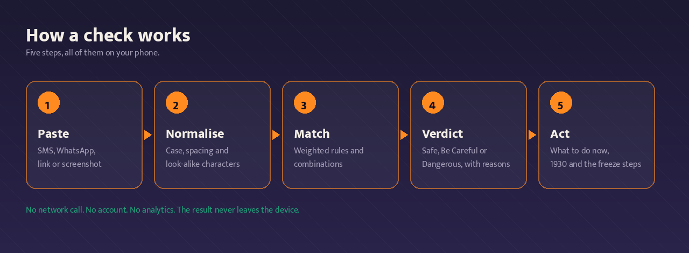
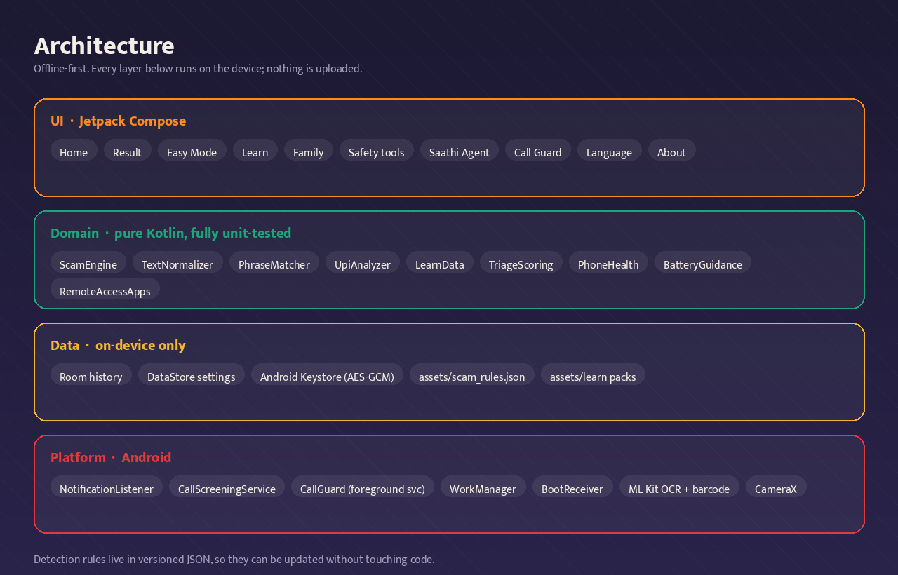

<div align="center">


# Suraksha Saathi · सुरक्षा साथी

**The message looks real. That is the whole problem.**

Every day in India, someone gets an SMS that says their KYC is expiring, or a WhatsApp call from a man who says he is from the CBI, or a job offer that wants a registration fee first. The message looks official. It has a logo, a reference number, a deadline. And the person reading it has about eight seconds to decide whether it is real.

Suraksha Saathi is for those eight seconds. Paste the message, and it tells you plainly what it looks like and what to do next. All of it happens on the phone, with no account, no server and no network.

[](https://github.com/premiumroy/BharatSurakshaSaathi/actions/workflows/android.yml)
[](https://github.com/premiumroy/BharatSurakshaSaathi/actions/workflows/release.yml)


<a href="https://github.com/premiumroy/BharatSurakshaSaathi/releases/latest">
  
</a>

**[हिन्दी में पढ़ें](#हिन्दी)** &nbsp;·&nbsp; [Privacy policy](PRIVACY_POLICY.md) &nbsp;·&nbsp; [Install guide](INSTALL_HINDI.md) &nbsp;·&nbsp; [Languages](LANGUAGES.md)

</div>

---

## Does it actually work?

This is the fair question, so let me answer it with numbers instead of adjectives.

The scam engine is pure Kotlin with no Android dependency, which means it can be tested properly. There are **228 automated tests**, and they run in seconds on a laptop without an emulator. The centre of that suite is a corpus of **150 labelled messages**: 68 genuine ones and 82 scams, written in English, Hindi and Hinglish, covering every family the app knows about and the tricks people use to slip past a filter.

The engine is scored against that corpus on every commit. It currently reports:

| | |
|---|---|
| Messages in the labelled corpus | 150 (68 genuine, 82 scam) |
| Scam families covered | 11 |
| Text rules | 33 |
| Combination rules | 20 |
| Suppression guards | 8 |
| False positives on the genuine set | 0 |
| Scams missed | 0 |

Two things are worth saying plainly about those numbers.

First, **zero false positives is a deliberate design choice, not a boast**. A safety app that cries wolf teaches people to ignore it, and then it is worse than useless. So the corpus is weighted with ordinary messages: bank alerts, delivery updates, OTPs you actually asked for, bills, a message from your mother asking you to pick up milk. If a rule fires on any of those, the build fails. That guard is the most important test in the repository.

Second, **the corpus is not the world**. It is 150 messages that I wrote and labelled. It proves the engine behaves as intended on those 150. It does not prove it will catch a scam that nobody has thought of yet, and it does not prove the app behaves well on a cheap phone with a cracked screen and a 2 GB RAM budget. That last part needs real devices and real people, and it is honestly still pending. If you install this and something goes wrong, that is exactly the feedback that makes it better.

## What it actually does

### Check a message

You paste an SMS, a WhatsApp message, or any text with a link in it. The engine normalises it first, because scammers mangle text on purpose: spaced-out letters, look-alike characters from other alphabets, mixed Hindi and English in the same sentence. Then it scores the message against the rules.

You get one of three verdicts, and the reasons behind it:

- **No clear danger seen.** It did not find the common patterns. It still tells you to stay alert, because it is not promising anything.
- **Please be careful.** Something is off, but not enough to be certain.
- **Danger. Stop.** This has the shape of a known scam.

Under the verdict you get a confidence level, the specific reasons in plain words, and a "what to do now" list that changes depending on what was found. If an OTP was being asked for, it says never share it. If there is a link, it says do not open it. If money is involved, it gives you 1930 and the freeze steps.

### Check a screenshot or photo

The messages that hurt people most are often sent as images, because a picture of an official letter looks more convincing than the same words typed out. You can pick a screenshot or take a photo, and ML Kit reads the text on the device. The same engine then checks it. Nothing is uploaded, and the model is bundled inside the app, so this works in aeroplane mode.

### Check a payment QR before you pay

This one exists because of a specific trick. Someone tells you they are sending you money, sends you a QR code, and says "scan this to receive". What they have actually sent is a *collect request*, which takes money **out** of your account when you approve it. You never need to scan a QR or enter a PIN to receive money. Ever.

The checker reads the QR on the device and tells you what is actually inside it: whether it is a collect request, whether an amount is already filled in, whether the payee name is copying a bank or a police department, and whether the handle is one it recognises. If the amount is large, it makes you pause and read the payee name again.

### Check a number

Type a number and it looks at the format offline. Nothing is looked up anywhere, because there is nowhere to look it up. It flags things like an international prefix, a repeated pattern that looks automated, a short code that is not one you saved. It never calls a number "safe", only "nothing unusual in this".

### If you were scammed

This is the part I hope nobody has to use, and it is written to be usable while your hands are shaking.

The first hour matters most, because that is when money can still be frozen. The screen asks when the money left, and counts the golden hour down. It gives you the four steps in order: call 1930, call your bank on the number printed on your own card, file the complaint at cybercrime.gov.in, and save your evidence. There is a place to record what happened, the amount, the numbers involved, and attach a screenshot, and it can export the whole thing as a PDF.

### Learn

Being told about a scam once does not stick. Being made to spot one does.

- **Spot the Scam** is a daily game with 40 cards. Swipe right if the message is real, left if it is a scam. There is a streak, badges, and a round summary at the end.
- **This week's scams** is 12 cards showing what is actually circulating right now, each with how it works, the warning signs, and what to do.
- **Call triage** is five questions about a call you just had. At the end it gives you a verdict and, if it looks bad, the fixed line the whole app is built around: someone asking for money on a video call or a phone is not police, CBI, a customs officer or a judge. Cut the call, dial 1930.
- **Calm mode** is a 20-second pause with three questions to ask yourself before sending money.

### Family

Scammers target the people least likely to push back. Two tools here are for them.

A **family code word** is one word only your family knows. If someone calls in a panic saying they are your son and they need money now, you ask for the code word first. It is stored encrypted on the phone with a key held in the Android Keystore, and it never leaves the device.

The **helper wizard** walks you through setting the app up on an elder's phone: picking the language they read best, turning on Easy Mode, turning on the message warning, and saving one family number so a dangerous result can be shared in one tap.

### Safety tools

A small drawer of things that matter in the moment: a dashboard of your checks and dangers caught, a shareable warning card with the private details masked, a helper that prepares a summary you can paste into the Sanchar Saathi portal, a step-by-step guide to seeing how many SIMs are registered against your Aadhaar, and a place to save the helplines from the back of your own card. The app deliberately ships no bank numbers, because a wrong helpline is more dangerous than no helpline.

### Saathi Agent (off by default)

The agent is the part that works while you are not looking, and every switch on it starts off.

**Message watch** reads the text of new message notifications from apps you choose, and warns you only when a message looks like a scam. It never reads your SMS store, and it never writes anything to disk.

**Call screening** checks the number of an incoming call on the phone, with no network, and shows a quiet tip for an unknown number. It never records or listens to a call, and it does not block anything unless you ask it to.

**Phone health** runs once a day, when the battery is not low, and looks at three things scammers abuse: unknown accessibility services, apps holding the permissions a takeover needs, and recently downloaded app files. It only looks. It never uninstalls, disables or changes anything. You get a score and up to three plain-language cards.

**Remote-access warning** notices when a screen-sharing tool and a banking or UPI app were used within half an hour of each other. That combination is how a screen-sharing scam usually ends, and it is the one case that gets an urgent notification.

You can pause the whole agent for an hour or for the day, and there is an honest list on screen of what it cannot see.

### Call Guard (started only by you)

During a scam call, the useful thing is to know what is being said to you. Call Guard listens through the phone's microphone, turns speech into text on the device, and matches it against the phrases that matter: CBI, police, customs, digital arrest, "do not disconnect", "tell no one", OTP, safe account, UPI.

It is started by a tap and never any other way. While it runs there is a persistent notification and an on-screen indicator, so there is no way for it to be on without you knowing. It never records audio and never keeps a transcript.

And it is honest about its own limits, on its own screen: Android does not allow any app to record call audio, so this only works on speakerphone, it hears the room as well as the call, and it may stop if the phone is very low on battery.

## How the detection works



The rules are not buried in Kotlin. They live in `app/src/main/assets/scam_rules.json`, in a versioned file you can read and edit:

- **11 families**, each with an English and a Hindi name and its own banner: digital arrest, investment, task and part-time job, family emergency, fake refund or tax or KYC, illegal loan apps, courier and customs, lottery and prize, romance and sextortion, fake customer care, and credential theft.
- **33 text rules**, each with an id, a family, a weight, a language, a set of regex patterns, and examples.
- **20 combination rules**, because real scams are rarely one signal. A parcel plus a customs fee plus a deadline is a courier scam; any one of those alone is nothing.
- **8 suppression guards**, which switch off specific rules in specific contexts. This is how a genuine message from your brother saying he has "free ho gaya" does not get read as a family-emergency scam.
- **5 link rule groups**: URL shorteners, suspicious TLDs, bank and government brand tokens, the official domains to compare against, and the signals that make a domain look like a copycat.

The thresholds are 25 for "be careful" and 60 for "danger", and they are in the same file.

Because it is a JSON file, the rules can improve without touching a line of code, and every change is reviewable in a diff. If you want to add a rule, add it there and add a matching labelled message to the test corpus. The corpus is what stops a well-meaning rule from creating false alarms.

## Architecture



```
app/src/main/java/com/bharatsuraksha/saathi/
├── domain/          pure Kotlin: engine, models, learn, safety, upi, agent
├── data/            Room, DataStore, on-device inspectors
├── service/         notification listener, call screening, Call Guard
├── work/            the daily phone-health job
└── ui/              Compose screens, theme, navigation, i18n
```

The rule the codebase tries hardest to keep is that `domain/` never imports anything from Android. That is why the engine, the triage scoring, the UPI parser, the number heuristics and the learn data can all be tested at full speed, and why the 228 tests are fast enough to run on every commit.

## Privacy, in plain words

**Everything you check stays on your phone.** Your history, your saved evidence, your blocklist, your family contacts, your trusted helplines, your code word, your settings. The code word is encrypted with AES-GCM and the key lives in the Android Keystore. There is no account, so there is nothing to log into. There is no analytics SDK, no crash reporting SDK and no advertising ID.

Three things can leave the phone, and all three need you to do something:

- **Auto-check** reads notification text on the device. It is not sent anywhere.
- **Online mode** is off by default. If you turn it on, enter a server address you control, and tap "Send it", exactly one message text goes to that address to get a plainer explanation. The app ships no API key. The optional `backend/` folder in this repo is a small self-hosted proxy you can run so that the key lives on your server and never in the app.
- **Report a wrong result** opens the share sheet with the message text already in it. Nothing is sent until you press send.

The app deliberately does **not** ask for `QUERY_ALL_PACKAGES`, `READ_SMS`, location, or `MANAGE_EXTERNAL_STORAGE`. Every permission it does ask for is explained on screen before the system prompt appears, and each one can be turned off again. The full list, with what each one does, is in [PERMISSIONS.md](PERMISSIONS.md).

You can erase everything in one tap: **Settings → Privacy and data → Delete all my data**.

Read the [privacy policy](PRIVACY_POLICY.md), which is in Hindi and English, or the [data safety answers](DATA_SAFETY.md) written for the Play Store form.

## Languages

The interface ships in **32 languages**, which is a slightly awkward thing to say, so here is the honest version.

Hindi and English are complete and checked. Marathi is complete and marked beta. The other 29 are declared, they appear in the picker in their own script, they carry a **बीटा / Beta** badge, and they fall back to Hindi for anything not translated yet. Every beta row has a "report a translation issue" link that opens a pre-filled message, because the fastest way to fix a bad translation is to let the person who noticed it tell you.

Scam detection is strongest in Hindi and English. The app says this on the language screen rather than pretending otherwise. [LANGUAGES.md](LANGUAGES.md) lists every language with its status and its detection level, and explains how to add one by editing a single plain `strings.xml`.

There is a test, `TranslationCompletenessTest`, that fails the build if any language file is missing a key, changes a placeholder like `%1$s`, or alters `1930`, `cybercrime.gov.in` or `sancharsaathi.gov.in`. A language cannot ship unless it passes.

## Install

**On a phone, the short way**

1. Open the **[latest release](https://github.com/premiumroy/BharatSurakshaSaathi/releases/latest)**.
2. Under **Assets**, tap `SurakshaSaathi-release.apk`. It downloads straight to your phone.
3. Open the downloaded file. Android will ask you to allow "install unknown apps" for your browser or file manager. Allow it, tap Install, then turn that permission back off.

Releases contain only the APK. The `.aab` for Google Play is deliberately never published here, because anyone holding an `.aab` can upload it to Play under their own account. Build your own with `./gradlew :app:bundleRelease` when you need it.

Step-by-step Hindi instructions are in [INSTALL_HINDI.md](INSTALL_HINDI.md).

**From source**

```bash
git clone https://github.com/premiumroy/BharatSurakshaSaathi.git
cd BharatSurakshaSaathi

./gradlew :app:testDebugUnitTest     # 228 tests, no emulator needed
./gradlew :app:assembleDebug         # debug APK

bash scripts/generate_keystore.sh    # once, for your own release key
./gradlew :app:assembleRelease       # signed release APK
```

You need JDK 17 and the Android SDK with platform 35. The release build runs R8 with resource shrinking and ships `arm64-v8a` and `armeabi-v7a` only, which covers essentially every Android phone in India and keeps the download smaller.

## Questions people actually ask

**Does it work without internet?**
Yes, all of it. The scam rules, the OCR model, the QR model, the learn cards and the whole interface are inside the app. Online mode is the only thing that ever touches a network, and it is off unless you turn it on.

**Does it read my SMS?**
No. The auto-check reads the text of *notifications* from apps you choose. It never opens your SMS store. The permission that would allow that is not requested at all.

**Can it record a call?**
No, and neither can any other Android app. Android does not allow it. Call Guard listens through the microphone, so it works on speakerphone only, and it says so on its own screen.

**Will it tell me something is safe?**
Never. It only ever says it did not find the common patterns, and it always adds that this is a helpful check and not a guarantee. **यह गारंटी नहीं है।**

**Is this a government app?**
No. It is independent and it is not affiliated with Sanchar Saathi, I4C, any bank, or any authority. Helpline numbers and portal addresses are shown for convenience only, and the app never submits a report on your behalf.

**Why does it need so many permissions?**
It does not, really. Only notifications is needed for the core experience. Everything else is for a feature you can leave switched off, and each one is explained before it is requested.

**Why is the release APK signed with a temporary key?**
Because a real upload key has to be generated and kept by the app's owner, and it is deliberately not in the repository. The published APK installs and works fine for sideloading. To publish on Play you generate your own key first.

## Contributing

The two most useful things you can send are **new scam rules** and **translations**, and neither needs you to write Kotlin.

If you have a scam message that got through, that is the single most valuable thing you can report. Paste it in an issue. If you want to go further, add it to `ScamCorpusV2.kt` as a labelled example, add the rule that catches it to `scam_rules.json`, and run the tests. If your rule also fires on a genuine message, the build will tell you.

For translations, copy `app/src/main/res/values/strings.xml` into `values-b+<tag>/strings.xml`, translate the values, keep every placeholder, and run the tests. [LANGUAGES.md](LANGUAGES.md) has the details.

Read [CONTRIBUTING.md](CONTRIBUTING.md) before opening a pull request. [QA_CHECKLIST.md](QA_CHECKLIST.md) is the manual checklist used before a release, and it is also a good list of the places where a change is most likely to break something.

## Not a government app

Suraksha Saathi is an independent app. It is **not** a government app, and it is not affiliated with, endorsed by or connected to Sanchar Saathi, I4C, the Cyber Crime Coordination Centre, any bank, or any authority.

## Credits

Made by **Roy Limited** · Owner: **Prashant Dobriyal** · known online as **Premium Roy**

The credit line lives in one place, `ui/about/Credits.kt`, so it is easy to change.

## License

[MIT](LICENSE). Take it, fork it, ship it in your own language, and help someone avoid losing their savings.

---

<a id="हिन्दी"></a>
## हिन्दी

**सुरक्षा साथी** एक मुफ़्त, ऑफ़लाइन सुरक्षा ऐप है।

किसी भी संदिग्ध SMS, WhatsApp मेसेज, लिंक या भुगतान QR को इससे जाँचिए और साफ़ जवाब पाइए: सुरक्षित, सावधान, या ख़तरा। साथ में यह भी कि ऐसा क्यों लगा, और अब क्या करना है।

सारी जाँच आपके फ़ोन में होती है। कोई लॉगिन नहीं, कोई विज्ञापन नहीं, कोई ट्रैकिंग नहीं, और कुछ भी अपलोड नहीं होता। इंटरनेट बंद हो तो भी यह पूरा काम करता है।

ऐप में यह सब है:

- मेसेज, स्क्रीनशॉट, लिंक, फ़ोन नंबर और UPI QR की जाँच
- ठगी हो जाने पर सबसे ज़रूरी कदम: 1930, बैंक को सूचना, cybercrime.gov.in पर शिकायत, और सबूत सहेजना
- सीखने के लिए खेल, इस हफ़्ते की ठगियाँ, और कॉल की जाँच के पाँच सवाल
- परिवार का कोड वर्ड, और बड़ों का फ़ोन सेट करने का सहायक
- साथी एजेंट: मेसेज पर नज़र, कॉल स्क्रीनिंग, रोज़ की फ़ोन जाँच (हर स्विच शुरू में बंद)
- कॉल सुरक्षा: कॉल के दौरान मदद, सिर्फ़ आपके चालू करने पर, साफ़ दिखने वाली सूचना के साथ

हिंदी और अंग्रेज़ी पूरी तरह तैयार हैं। बाकी 30 भाषाएँ बीटा हैं, अपनी लिपि में दिखती हैं, और जो छूट जाए वह हिंदी में दिख जाता है।

**यह मददगार जाँच है, गारंटी नहीं। यह गारंटी नहीं है।**

यह ऐप सरकारी नहीं है और Sanchar Saathi, I4C, किसी बैंक या किसी प्राधिकरण से जुड़ा नहीं है।

इंस्टॉल करने का तरीका [INSTALL_HINDI.md](INSTALL_HINDI.md) में है।

<div align="center">

**Made by Roy Limited**

</div>
